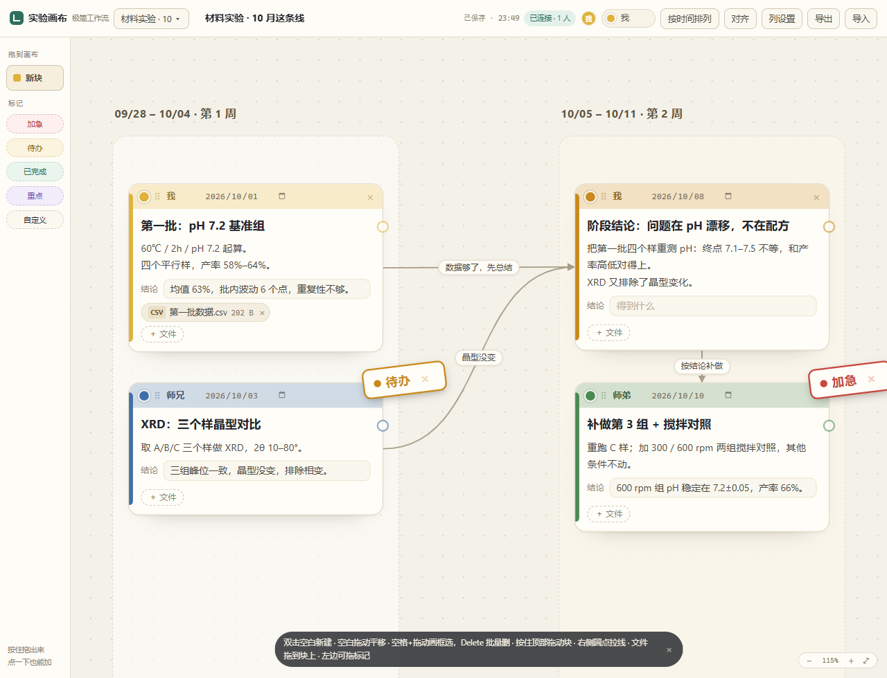

# 实验画布 · labflow-canvas

一张可以随便摆的实验记录画布：每块写「做了什么 / 结论」，Excel 直接拖上去，块之间拉箭头，按周分列；支持**局域网多人实时共享**，没网时退回单机，用 JSON 导出/导入合并。



- 单文件前端 + Python 标准库后端，**零第三方依赖**
- 多张画布（周计划 / 日计划 / 实验计划各一张）
- 拖拽、空格框选、批量删除、按列对齐、吸附参考线
- 附件按内容指纹去重，删除保留墓碑，离线合并不会复活旧数据
- 可以打包成 zip 发给别人，或让聊天 AI 按 `AI-指导说明.md` 带着装

## 三种用法

| 场景 | 怎么做 | 需要 |
| --- | --- | --- |
| 一个人，先试试 | 双击 `index.html`（或包里的 `直接打开-单机版.html`） | 浏览器 |
| 同一个 WiFi 多人实时 | `start.cmd`（Windows）/ `./start.sh`（macOS/Linux） | Python 3.9+ |
| 没网 / 不想装 Python | 各自用单机版编辑 → 导出 JSON → 对方导入自动合并 | 浏览器 |

## 快速开始

### Windows

```bat
start.cmd
```

会自动打开浏览器并启动服务。第一次 Windows 防火墙弹窗请勾选「专用网络」。

### macOS / Linux

```sh
chmod +x start.sh
./start.sh
```

### 手动

```sh
python server.py
```

默认 `http://127.0.0.1:43300`；同一局域网用启动日志里打印的 `http://<本机IP>:43300`。
端口/数据目录可用环境变量：

```sh
LABFLOW_PORT=43301 LABFLOW_DATA=/tmp/labflow python3 server.py
```

没有 Python 时，`start.cmd` 会自动打开单机版并提示安装步骤。

## 常用操作

- **移动画布**：空白处直接拖动；中键拖动也可以
- **框选**：按住 **空格** 拖动，圈住块和「加急/待办」标记，按 `Delete` 批量删除（可撤销）
- **新建**：左侧面板拖出「新块」，或双击空白
- **连线**：从块右侧圆点拖到另一块，松手写说明
- **附件**：拖到块上，或点「＋ 文件」；可挂多个
- **多画布**：顶栏「画布 ▾」新建/切换/改名，每张画布独立
- **对齐**：「按时间排列」按日期摆进列里（再点一次恢复原位）；「对齐」把每一列从上往下按实际高度排好
- **颜色/标记**：块左上角色点换色；左侧「加急/待办/已完成/重点/自定义」拖到块上
- **导出**：JSON（可再导入、带附件）/ Markdown（给人看）；浏览器打印可存 PDF

## 数据与隐私

- 共享模式：`data/boards/<画布id>.json` + `data/uploads/`（附件，sha256 命名）
- 单机模式：浏览器 localStorage + IndexedDB
- 没有账号系统，进来说名字就能改；适合小团队内网使用，不要直接暴露到公网
- 备份：拷走整个 `data/`；清空：删掉 `data/`

## 仓库结构

```
index.html     前端全部（结构/样式/逻辑，单文件）
server.py      后端：HTTP + SSE + 多画布 JSON 落盘
start.cmd      Windows 启动
start.sh       macOS/Linux 启动
smoke.py       无依赖接口冒烟（11 项）
check.mjs      浏览器实机检查（开发用，需 Chrome + Node）
package.py     打包成可分发 zip
AGENT.md       给 AI/开发者的说明书
AI-指导说明.md  给聊天 AI 的“教人安装”脚本
开始使用.txt     给普通人的三步说明
诊断.cmd        Windows 环境诊断
legacy/        早期单列时间轴版本（仅留档）
```

## 开发与测试

```sh
# 接口冒烟（先起服务）
python smoke.py http://127.0.0.1:43300

# 前端内联脚本语法检查
node -e "const fs=require('fs');const h=fs.readFileSync('index.html','utf8');const m=h.match(/<script>([\\s\\S]*?)<\\/script>/);new Function(m[1])"

# 浏览器实机检查（需调试模式 Chrome）
chrome --headless=new --remote-debugging-port=9223 --user-data-dir=/tmp/chrome-labflow
node check.mjs
```

GitHub Actions 会跑 Python 语法、启动服务 + 冒烟、前端语法和打包（见 `.github/workflows/ci.yml`）。

## 已知限制

- 冲突按「整条记录最后写入赢」，依赖各机器时钟；不是字段级合并
- 没有账号/权限；不要把 43300 直接映射到公网
- 块宽度固定 320；连线不会自动避让
- 附件在单机模式下受浏览器存储限制（重要内容请导出 JSON）
- 不支持实时协作以外的云端同步

## 许可

MIT，见 [LICENSE](LICENSE)。欢迎 issue / PR；改 `index.html` 时注意前端和后端的 `merge_board` 规则必须保持一致。
